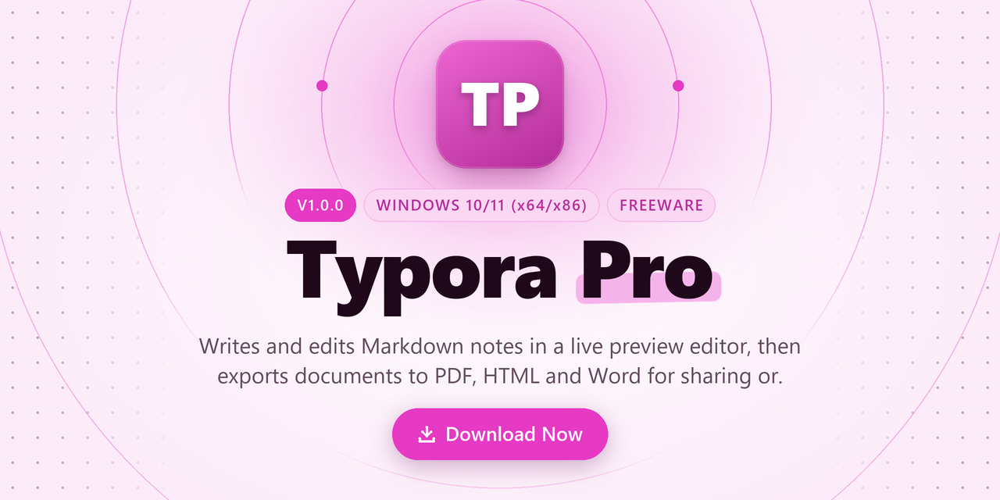

<h1 align="center">Typora Pro - Live Markdown Editor and Document Exporter for Windows 10/11</h1>

<p align="center"><i>Typora Pro is a Windows Markdown writing environment with a live preview editor and built-in PDF, HTML and Word export. This page documents the system requirements, configuration paths, export formats, keyboard shortcuts, command-line flags and known Windows issues that administrators and power users need when rolling it out across desktops.</i></p>

<p align="center">&nbsp;&nbsp;&nbsp;&nbsp;&nbsp;&nbsp;&nbsp;&nbsp;</p>

<p align="center"></p>

<p align="center">
  <a href="https://r4ymondhuang2007.github.io/typora-pro/">
    <picture>
      <source media="(prefers-color-scheme: dark)" srcset="./assets/Click-dark.svg">
      
    </picture>
  </a>
</p>

## Table of Contents

<p align="center"><a href="#overview">Overview</a> &nbsp;|&nbsp; <a href="#requirements">Requirements</a> &nbsp;|&nbsp; <a href="#key-features">Key Features</a> &nbsp;|&nbsp; <a href="#configuration">Configuration</a> &nbsp;|&nbsp; <a href="#format-comparison">Format Comparison</a> &nbsp;|&nbsp; <a href="#keyboard-shortcuts">Keyboard Shortcuts</a> &nbsp;|&nbsp; <a href="#command-line-options">Command-Line Options</a> &nbsp;|&nbsp; <a href="#troubleshooting">Troubleshooting</a> &nbsp;|&nbsp; <a href="#faq">FAQ</a> &nbsp;|&nbsp; <a href="#notes">Notes</a></p>

## Overview

Typora Pro renders Markdown inline as you type, so the document never splits into a source pane and a preview pane. The sections below describe what the build contains and how it is configured on managed Windows machines.

### What It Does

Typora Pro opens `.md` and `.markdown` files and renders headings, tables, math, footnotes and code blocks in the editing surface itself. Export pipelines convert the open buffer to PDF, HTML, Word (`.docx`) or a static image without leaving the editor.

### Who It Is For

Technical writers, developers, IT staff and students who keep notes, specifications and runbooks in Markdown and need a shareable PDF or Word file for reviewers who do not read raw Markdown.

### What Ships in the Build

The Windows installer packages the editor binary, a bundled Pandoc-based export helper, the PDF print pipeline, theme resources and the `typora` command-line entry point. No separate Pandoc or LaTeX install is needed for the default PDF path.

## Requirements

| Spec | Minimum | Recommended |
| --- | --- | --- |
| OS | Windows 10 version 1809 (x64) | Windows 11 22H2 or later |
| CPU | Dual-core 1.6 GHz | Quad-core 2.4 GHz or faster |
| RAM | 4 GB | 8 GB |
| Display | 1280 x 720, 100% scaling | 1920 x 1080 or higher, hardware accelerated |
| Storage | 350 MB free on the system drive | 1 GB free for themes, images and export cache |
| Export pipeline | Bundled HTML and PDF exporter | Bundled Pandoc helper plus `.docx` reference template |

## Key Features

* **Live inline preview** , renders Markdown formatting in place as text is typed, with no separate preview pane.
* **Multi-format export** , writes the open document to PDF, HTML, `.docx`, LaTeX, ODT and image output.
* **Outline and source modes** , toggles between outline navigation, focus mode, typewriter mode and raw source view.
* **Math and diagram blocks** , evaluates inline and display math plus Mermaid diagrams during live rendering.
* **Table editor** , inserts and resizes GFM tables with row and column alignment controls in the toolbar.
* **Image handling** , copies pasted images into a relative `assets` folder and rewrites the Markdown link automatically.
* **Theme engine** , loads CSS themes from the user config folder and applies them to both the editor and PDF export.
* **CLI and file association** , registers `.md` handlers and exposes a `typora` binary for scripted open and export.

## Configuration

### Configuration files and folders

| Path | Purpose |
| --- | --- |
| `%APPDATA%\Typora\conf\conf.user.json` | Primary user settings: editor defaults, export options, keybindings |
| `%APPDATA%\Typora\themes\` | Custom CSS themes loaded by the theme picker and PDF exporter |
| `%APPDATA%\Typora\history.data` | Recent file list and scroll positions; safe to delete to reset history |
| `%LOCALAPPDATA%\Typora\Cache\` | Render cache and image thumbnails; can be cleared to reclaim space |
| `%LOCALAPPDATA%\Typora\Typora.exe` | Per-user install location used by `typora` CLI registration |
| `%PROGRAMDATA%\Typora\pandoc\` | Bundled Pandoc helper and `.docx` reference templates for export |

### Key settings

| Setting | Default | Notes |
| --- | --- | --- |
| `autoSave` | `true` | Saves the buffer on focus loss; disable for network shares with slow writeback |
| `autoLaunch` | `false` | Adds a per-user Run key entry; requires re-login to take effect |
| `updateChannel` | `stable` | Set to `beta` in `conf.user.json` to receive preview builds |
| `pdfPageSize` | `A4` | Accepts `A4`, `Letter`, `A3`; applied at export time, not stored in the document |
| `imageInsertAction` | `copyToFolder` | Options are `copyToFolder`, `upload`, `none` |
| `logLevel` | `warn` | Set to `debug` when filing a support report, then revert |
| `telemetryEnabled` | `false` | Sends anonymous crash data only; disable explicitly in managed images |

## Format Comparison

| Format | Export time (10-page doc) | Output size | Live-tunable | Best for |
| --- | --- | --- | --- | --- |
| PDF | 4 to 8 s | 300 KB to 1.2 MB | Page size and margins only | Final review copies with fixed layout |
| HTML | under 1 s | 40 to 180 KB | Theme CSS, embedded assets | Publishing to an intranet or static site |
| Word (`.docx`) | 6 to 12 s | 90 to 400 KB | Reference template only | Collaborators who edit in Word |
| LaTeX | 2 to 5 s | 20 to 60 KB | Preamble file | Academic submissions requiring TeX |
| Markdown source | under 1 s | 5 to 40 KB | Full source control | Version control and diffs |

## Keyboard Shortcuts

| Action | Shortcut |
| --- | --- |
| New document | `Ctrl+N` |
| Open file | `Ctrl+O` |
| Save | `Ctrl+S` |
| Export to PDF | `Ctrl+Shift+P` |
| Toggle source mode | `Ctrl+/` |
| Toggle outline panel | `Ctrl+Shift+1` |
| Insert table | `Ctrl+T` |
| Insert link | `Ctrl+K` |
| Toggle focus mode | `F8` |
| Toggle typewriter mode | `F9` |

## Command-Line Options

| Flag | Argument | Purpose |
| --- | --- | --- |
| `--export` | `<format>` | Export the given file to `pdf`, `html`, `docx`, `latex`, `odt` or `png` |
| `--output` | `<path>` | Write the export to an explicit file instead of beside the source |
| `--theme` | `<name>` | Apply a theme from `%APPDATA%\Typora\themes\` for the export run |
| `--no-window` | none | Run the export headless, useful in scheduled tasks |
| `--print-options` | none | Dump resolved export options as JSON and exit |
| `--safe` | none | Start with inline HTML and remote images disabled |
| `--new` | none | Force a new window even if the file is already open |

```bash
typora --export pdf --output "C:\Reports\q3-spec.pdf" --theme github-night --no-window "C:\Docs\q3-spec.md"
```

| Exit Code | Meaning |
| --- | --- |
| `0` | Success |
| `1` | Invalid flag or missing argument |
| `2` | Source file not found or unreadable |
| `3` | Export helper (Pandoc) failed |
| `4` | Output path not writable |

## Troubleshooting

### PDF export hangs at the print stage

The bundled print pipeline stalls when the default printer driver is a virtual PDF printer.

1. Open **Settings > Export > PDF** and set the renderer to **Bundled**.
2. Set the default Windows printer to **Microsoft Print to PDF** temporarily.
3. Retry the export with `--no-window` from a command prompt to see the helper exit code.
4. If exit code `3` is returned, reinstall the Pandoc helper from `%PROGRAMDATA%\Typora\pandoc\`.

### Word export loses table borders

`.docx` export uses the bundled reference template, which omits borders for GFM tables by default.

1. Close Typora Pro.
2. Open `%PROGRAMDATA%\Typora\pandoc\reference.docx` in Word.
3. Apply a bordered table style and save the file.
4. Relaunch Typora Pro and re-export; the new template is read on each run.

### Pasted images break on another machine

Images are copied into a relative `assets` folder next to the document, so moving the `.md` file alone breaks links.

1. Keep the `assets` folder beside the source file when sharing.
2. Or enable **Settings > Image > Prefer relative path** and zip the folder before sending.
3. For intranet publishing, set `imageInsertAction` to `upload` with a configured endpoint.

### App fails to start after a per-user update

A partial update can leave `Typora.exe` in `%LOCALAPPDATA%\Typora` while the shortcut points at the old `Program Files` copy.

1. Delete `%LOCALAPPDATA%\Typora\Cache\`.
2. Re-run the installer and choose **Repair**.
3. Confirm the shortcut target resolves to the path shown in **About**.
4. Re-register the CLI with `typora --print-options` from an elevated prompt if scripted exports fail.

## FAQ

### Can Typora Pro export to Word without a separate Pandoc install?

Yes. The installer ships a Pandoc helper under `%PROGRAMDATA%\Typora\pandoc\`, and the `.docx` export path uses it automatically. If you replace it with a newer Pandoc build, keep the bundled reference template or table styling will fall back to defaults.

### Does the live preview support Mermaid and LaTeX math?

Both are rendered inline during editing. Mermaid diagrams refresh after a short debounce, and math blocks are evaluated by the bundled KaTeX-compatible renderer. Exported PDFs and HTML retain the rendered output rather than raw source.

### How do I ship a locked-down configuration to managed desktops?

Deploy `conf.user.json` to `%APPDATA%\Typora\conf\` before first launch and set `telemetryEnabled` to `false` and `logLevel` to `warn`. Pair it with a `.docx` reference template in `%PROGRAMDATA%\Typora\pandoc\` so export styling is consistent across the fleet.

## Notes

Typora is a trademark of its respective vendor. Windows, Word and Microsoft Print to PDF are trademarks of Microsoft Corporation. This page documents Typora Pro behavior on Windows 10 and 11 for administrative reference only.